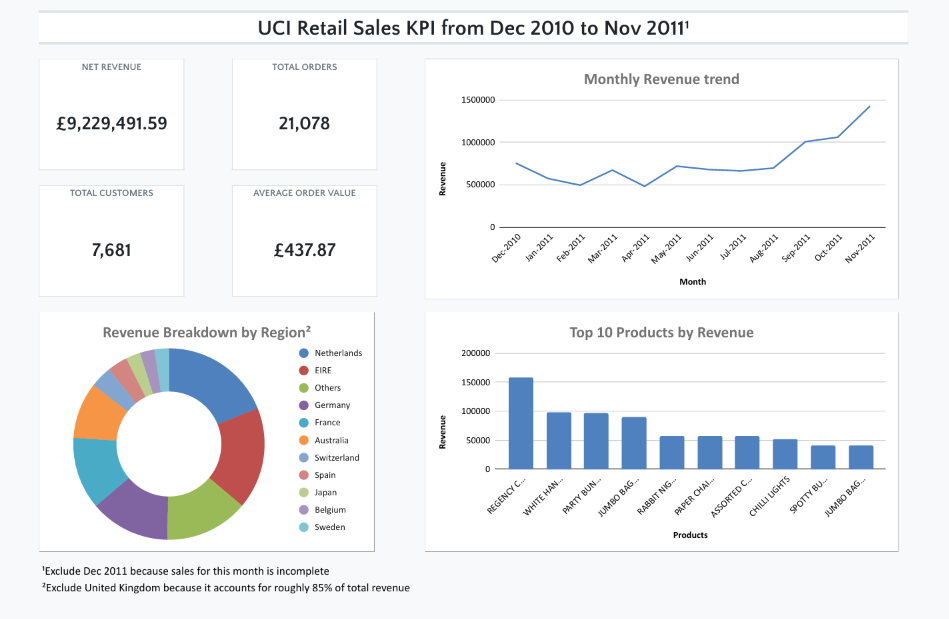

# UCI Retail Sales KPI Dashboard (Python → Excel)

   

The pipeline cleans ~540 k UK online retail transactions, separates true net sales from cancellations, fees and adjustments, and produces an audit‑logged Excel KPI dashboard in a single run.

## The Problem
Raw sales exports are unreliable. The dataset from a UK online gift wholesaler mixes genuine product sales with cancellations, postage, Amazon fees, bank charges, bad‑debt adjustments, manual edits, duplicate rows and an incomplete final month. Summing the revenue column as‑is yields incorrect totals.

**Question:** How did net product sales perform from Dec 2010 to Nov 2011, and where did the revenue originate?

**Definition:** Net sales = product sales – cancellations. Postage, fees, bank charges, bad debt, duplicates and Dec 2011 are excluded. Full reasoning appears in the `Log` sheet of `Dashboard.xlsx`.

## Findings
1. Strong Q4 seasonality. Net revenue totaled £9.23 M over 12 months. September–November 2011 alone generated £3.49 M (37.9 %). November 2011 (£1.43 M) outpaced December 2010 (£755 k) by 89 %.
2. Revenue concentration by country. The UK accounts for ~85 % of revenue. The largest non‑UK markets are the Netherlands (£271 k), Ireland (£247 k), Germany (£194 k) and France (£176 k).
3. Long‑tail product mix. The top product, Regency Cakestand 3 Tier, earned £158.6 k. The top 10 products represent only ~8 % of net revenue.
4. Cancellations matter. They offset £457 k, about 4.7 % of gross product sales, so they must be netted out.

## Key features
- Rule‑based classification: Eight priority‑ordered categories (sales, cancellations, expenses, duplicates, bad debt, manual adjustments with/without customer ID, incomplete month) plus a zero‑unknown check.
- Business‑correct net sales: Cancellations are subtracted; postage, fees, bank charges, bad debt and duplicates are excluded.
- Audit Log sheet: Shows row share, monetary impact, keep/remove decision and written rationale for every category.
- One‑run Excel dashboard: Four KPI cards, monthly revenue trend, top 10 products and non‑UK revenue by region, all as native

## Why this architecture?
- pandas + `np.select`: Rules run in priority order, assigning one label per row. An assertion halts the run if any row remains unclassified.
- openpyxl: The output is a native .xlsx with real Excel charts and tables. Stakeholders open it without Python or a Power BI license.
- A Log sheet instead of silent filtering: Every exclusion is visible and justified.

**Trade‑offs:** A notebook is easy to read and audit, but harder to schedule than a script. Chart references depend on table positions. Reading ~540 k rows with `read_excel` is slow; CSV or Parquet would load faster. The output is a static snapshot; rerun the notebook to refresh it.

## How to run
1. Install Python 3.12+ and run `pip install -r requirements.txt`.  
2. Download the dataset from [UCI: Online Retail](https://archive.ics.uci.edu/dataset/352/online-retail) and place `Online Retail.xlsx` next to the notebook.  
3. Open `UCI_Retail_Sales.ipynb`, run all cells, and `Dashboard.xlsx` will be generated.

## Known limitations
- Total Customers (7,681) is an upper bound. Guest checkouts lack a CustomerID, so each guest invoice counts as a separate customer: 4,297 registered customers + 3,384 guest orders.  
- Duplicate rows are assumed to be system errors, though some may be genuine repeat line items.

## Tech stack
- Language: Python  
- Data processing: pandas, NumPy  
- Output: openpyxl, Microsoft Excel  
- Environment: Jupyter Notebook  

## Data credit
Chen, D. (2015). Online Retail [Dataset]. UCI Machine Learning Repository. https://doi.org/10.24432/C5BW33. Licensed under CC BY 4.0.
